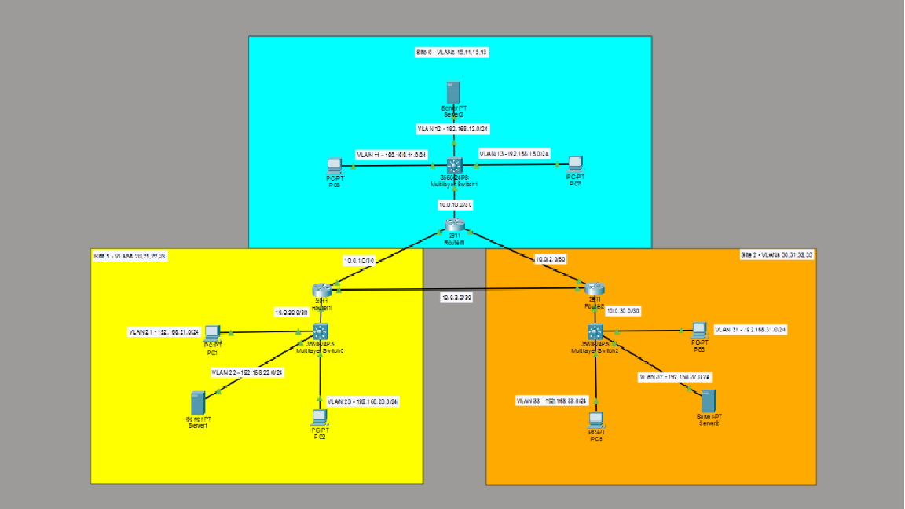

# Multi-Site Enterprise Network — Cisco Packet Tracer

## Project Overview

Designed, configured, and tested a three-site enterprise network using Cisco Packet Tracer. The project demonstrates enterprise routing, VLAN segmentation, Layer 3 switching, dynamic route propagation, and Layer 2 security.

The network connects three geographically separate simulated sites using a redundant router topology and OSPF Area 0.

## Network Architecture

The topology consists of:

- **3 Cisco 2911 routers** — R1, R2, R3
- **3 Cisco 3560 Layer 3 switches** — SW1, SW2, SW3
- **9 VLANs** — Three per site
- **9 end devices** — Management PCs, servers, and employee PCs
- **6 routed point-to-point links** — Three inter-router connections and three router-to-switch connections

The routers form a full-mesh triangle, providing alternate network paths between sites.

Each Layer 3 switch performs inter-VLAN routing for its local site and exchanges routes with its connected router using OSPF.

## IP Addressing and VLAN Design

| Site | VLAN | Purpose | Subnet | Default Gateway |
|---|---|---|---|---|
| Site 1 | 11 | Management | 192.168.11.0/24 | 192.168.11.1 |
| Site 1 | 12 | Servers | 192.168.12.0/24 | 192.168.12.1 |
| Site 1 | 13 | Employees | 192.168.13.0/24 | 192.168.13.1 |
| Site 2 | 21 | Management | 192.168.21.0/24 | 192.168.21.1 |
| Site 2 | 22 | Servers | 192.168.22.0/24 | 192.168.22.1 |
| Site 2 | 23 | Employees | 192.168.23.0/24 | 192.168.23.1 |
| Site 3 | 31 | Management | 192.168.31.0/24 | 192.168.31.1 |
| Site 3 | 32 | Servers | 192.168.32.0/24 | 192.168.32.1 |
| Site 3 | 33 | Employees | 192.168.33.0/24 | 192.168.33.1 |

### Routed Infrastructure

| Connection | Subnet |
|---|---|
| R1 ↔ R2 | 10.0.1.0/30 |
| R1 ↔ R3 | 10.0.2.0/30 |
| R2 ↔ R3 | 10.0.3.0/30 |
| R1 ↔ SW1 | 10.0.10.0/30 |
| R2 ↔ SW2 | 10.0.20.0/30 |
| R3 ↔ SW3 | 10.0.30.0/30 |

## Routing and Switching

## Network Topology

